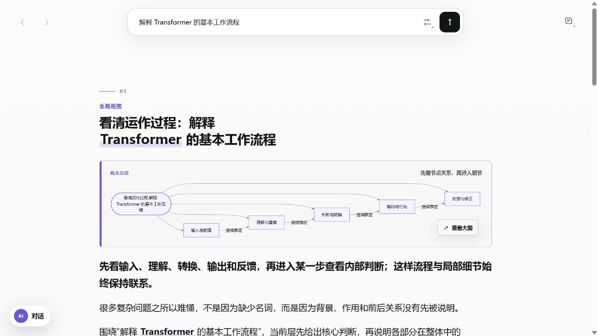
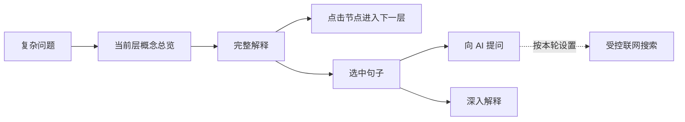
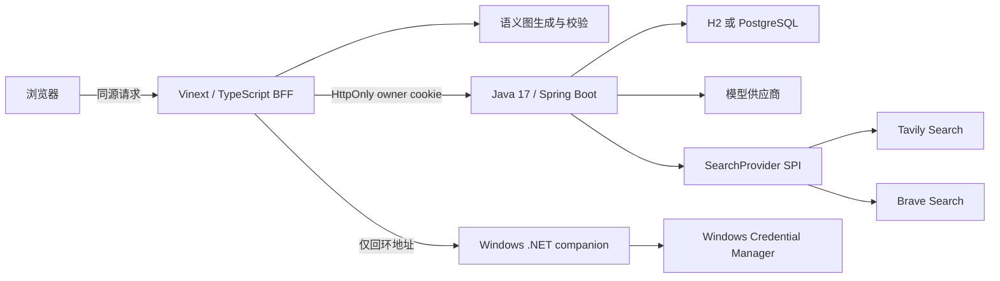

# Visualized Exp

把复杂问题展开成一个可以阅读、追问和继续深入的 AI 可视化解释空间。

Visualized Exp 不把回答一次性压成长文或固定模板。它先生成当前层的解释与概念关系，只预备下一层入口；用户可以沿节点递归探索，也可以选中一句话直接向 AI 提问或继续深入。





## 核心体验

- 递归语义缩放：根场景只展示 3–6 个高层入口，点击节点进入下一层，并用 `‹ / ›` 沿探索历史移动。
- 概念先行：开头用 Mermaid 绘制当前层概念关系；可打开大图并在 100%–300% 之间缩放。
- 渐进生成：只预生成当前入口的直接子场景，避免提前铺开整张知识图谱。
- 选区双入口：选中正文后可选择“向 AI 提问”或“深入”；左侧对话栏按需打开且可以关闭。
- 语境化名词解释：仅 AI 标注的名词可点击，解释不会修改主语义文档。
- 历史会话：Java 后端持久化知识会话和选区对话，支持刷新恢复、切换与删除。
- 可选联网：主问题提供开/关；选区对话每轮可选关闭、自动或强制。搜索服务已配置不等于已经允许联网。
- 离线演示：没有模型密钥时仍可使用确定性的演示生成器体验主要浏览流程。

## 模型、协议与搜索服务

“供应商预设”只是可编辑的默认值，不是项目分别实现了每家厂商的私有协议。当前 Java 模型通道实现两种协议：

| 类型 | 当前实现 |
| --- | --- |
| 模型协议 | OpenAI Chat Completions、Anthropic Messages |
| 模型预设 | OpenAI、Anthropic、DeepSeek、Kimi、GLM、Gemini、通义千问、OpenRouter |
| 自定义模型 | 可配置 Base URL/完整请求 URL、模型 ID、协议和受限认证 Header |
| 搜索适配器 | Tavily Search、Brave Search |

Tavily 当前只用于搜索（Search），未接入 Extract、Crawl、Map 或 Research。搜索 API Key 属于搜索供应商鉴权，与模型 API Key 相互独立；`web_search` 工具本身并不天然要求某一家供应商或某一种 Key。

语义图生成默认通过本机 DeepSeek companion 使用项目定义的 Pro/Flash 模型路由。选区对话在没有启用模型覆盖时复用该通道；只有用户明确保存并启用模型覆盖后，新对话才改用 Java 中的供应商配置，无需重复配置同一把 DeepSeek Key。

## 系统结构



关键边界：

- 语义文档是知识结构的唯一事实来源；节点保存内容、层级、关系和展示建议，不保存像素坐标或 React 组件名。
- 模型只提交受验证的语义操作或受限的 `web_search(query, freshness?)` 调用，不能指定搜索请求 URL。
- 供应商 Key 只写不回显。Windows companion 将默认 DeepSeek Key 保存在系统凭据管理器；Java 使用 AES-256-GCM 加密模型覆盖和搜索供应商 Key。
- Java 对话提交使用稳定的 `clientTurnId`，持久化 `PENDING / COMPLETED / FAILED / UNKNOWN` 状态，无法确认结果时不会盲目重放付费请求。

更多设计细节见 [最小视觉对话规范](specs/minimal-visual-conversation.md)、[会话与凭据边界](specs/conversation-source-and-credentials.md)和 [Java 后端说明](backend/README.md)。

## 环境要求

完整的 `dev:local` 本地体验目前面向 Windows，因为它依赖 Windows Credential Manager。

| 依赖 | 最低版本 |
| --- | --- |
| Node.js | 22.13.0 |
| Java | 17 |
| Maven | 3.6.3 |
| .NET SDK | 10.0 |

## 快速开始

安装依赖并启动 companion、Java 后端和网站：

```powershell
npm install
npm run dev:local
```

默认访问 `http://localhost:3000`。首次使用时打开右侧设置：

1. 在上方保存 DeepSeek Key，用于语义图和默认选区对话。
2. 如有需要，在“模型覆盖”中配置其他模型供应商。
3. 如需联网，配置并启用搜索供应商，再在搜索服务区域允许下一次主问题联网；选区对话仍按每轮单独选择。

保存模型或搜索配置会发起一次最小验证请求，可能计入供应商用量。

只体验不调用真实模型的前端演示：

```powershell
$env:EXPLANATION_MODEL_PROVIDER = "demo"
npm run dev
```

该模式不会自动启动 Java 后端，因此不包含持久化历史和选区对话。手动拆分进程、PostgreSQL 配置及服务端环境变量见 [backend/README.md](backend/README.md) 和 [.env.example](.env.example)。任何密钥都不得使用 `NEXT_PUBLIC_` 前缀。

## 验证

完整的本地发布门禁：

```powershell
npm run harness:minimal
```

该命令会依次运行 companion 构建、Java 测试、前端构建、Node 测试、TypeScript 类型检查和 ESLint。也可以单独运行：

```powershell
npm test
npm run typecheck
npm run lint
```

自动化测试不需要真实 API Key，也不应发起真实模型或搜索请求。

## 安全与部署边界

本项目当前是本地优先、单用户应用。HttpOnly owner cookie 只用于同一设备上的数据隔离，不是账号登录、强身份认证或多设备同步方案。

不要把当前本地配置直接当作公开多用户生产服务。公开部署前至少需要补齐：

- 真实的身份认证、授权与租户隔离；
- 请求速率限制、并发上限、配额和费用预算；
- HTTPS、服务端 Secret Manager 和密钥轮换；
- 数据库备份、迁移与恢复演练；
- 出站网络防火墙或代理、审计日志和运行监控。

请勿提交 `.env`、API Key、Token、数据库文件、日志、个人会话或包含这些内容的截图。安全问题请按 [SECURITY.md](SECURITY.md) 私下报告。

## 参与贡献

提交代码前请阅读 [CONTRIBUTING.md](CONTRIBUTING.md)，并运行完整门禁。行为变更还应同步更新 `docs/feature-flows/` 中对应的流程与可追溯信息。

## 版本与许可证

- 版本记录：[CHANGELOG.md](CHANGELOG.md)
- 许可证：[MIT](LICENSE)
