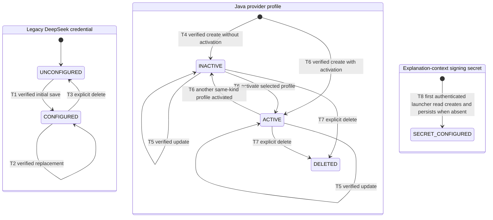

# Configure model and search providers

## Purpose

Maintain two protected credential stores with one explicit runtime precedence:

1. The existing semantic-lineage lane continues to use one local DeepSeek
   credential through the authenticated Windows companion. It drives fixed
   `deepseek-v4-pro` scene/dive requests and `deepseek-v4-flash` definition
   requests. In local mode the same companion becomes the default
   `deepseek-v4-pro` transport for selection chat, without copying or revealing
   the Windows credential to Java.
2. The Java backend stores optional owner-scoped model overrides and separate
   owner-scoped search profiles. Model presets are editable templates rather
   than fixed runtime routes. They support OpenAI Chat Completions and Anthropic
   Messages, base or complete request URLs, four bounded
   header-authentication modes, common presets including Kimi and GLM plus an
   autonomous provider template, and a selected model ID. The settings
   workspace keeps the configured-profile list compact on the left and gives
   the editable model form the larger, square-edged right column. Search remains a separate provider lane:
   `SearchProviderRegistry`
   resolves the saved provider type to exactly one fixed-origin Tavily or Brave
   adapter, with Tavily as the default product choice. One model and one search
   profile may be active for an owner.

Selection chat resolves its model in a fixed order: the owner's active Java
model override, then the authenticated local companion DeepSeek transport, then
a typed `provider_not_configured` failure. Adding a Java model profile never
changes `/api/lineage`; it only overrides the local DeepSeek default for that
owner's selection chat. Search-provider activation selects a route and does not
itself grant a turn permission to search.

## Credential roots and startup

The local launcher authenticates to the loopback Windows companion with a
per-start bearer and reads/creates one stable explanation-context secret in
Windows Credential Manager. Unless an explicit Java credential master key is
provided, the launcher derives a distinct 32-byte Java master key with HMAC
domain separation and passes it only to the Java process. Java encrypts provider
keys with AES-256-GCM and owner/config/provider associated data before database
storage.

The launcher also creates a separate per-start Java internal bearer. The browser
calls only the same-origin `/api/backend` route; that route adds the bearer and
an HttpOnly device-owner identity. Neither API returns plaintext provider keys.

## Runtime flow

```mermaid
flowchart TD
    E1(["E1 Save or replace legacy DeepSeek Key"]) --> D1{"D1 Authenticated loopback companion available"}
    D1 -->|No| X1(["X1 Reject legacy save; prior state unchanged"])
    D1 -->|Yes| D2{"D2 Trusted JSON request within 2 KiB and bounded single-line Key"}
    D2 -->|No| X1
    D2 -->|Yes| A1["A1 Verify fixed DeepSeek models endpoint"]
    A1 --> D3{"D3 Key authenticates and Pro plus Flash are listed"}
    D3 -->|No| X1
    D3 -->|Yes, first save| T1["T1 Store Windows generic credential"]
    D3 -->|Yes, replacement| T2["T2 Replace Windows credential after verification"]
    T1 --> X2(["X2 Return configured status without Key"])
    T2 --> X2

    E2(["E2 Delete legacy DeepSeek Key"]) --> T3["T3 Idempotently delete Windows credential"]
    T3 --> X3(["X3 Legacy lane becomes unconfigured"])

    E3(["E3 Semantic lineage requests model"]) --> A2["A2 Companion reads legacy Key and proxies allowlisted Pro or Flash"]
    A2 --> X4(["X4 Return provider response without Key"])

    E4(["E4 Local launcher starts"]) --> D9{"D9 Stable explanation-context secret already exists"}
    D9 -->|No| T8["T8 Generate and persist first signing secret"]
    D9 -->|Yes| A3["A3 Return stable secret over authenticated loopback"]
    T8 --> A3
    A3 --> D4{"D4 Authenticated secret is valid and at least 32 bytes"}
    D4 -->|No| X5(["X5 Fail local startup"])
    D4 -->|Yes| A4["A4 Derive Java master key and start loopback Java backend with internal bearer plus companion origin and bearer"]
    A4 --> X6(["X6 Start web worker with separate companion and Java bindings"])

    E5(["E5 Choose a preset including Kimi or GLM, or save a custom selection-chat provider"]) --> A5["A5 Send write-only Key through trusted same-origin Java proxy within 4 MiB"]
    A5 --> D5{"D5 Kind, API format, address mode, auth header, model, URL, and Key input valid"}
    D5 -->|No| X7(["X7 Reject candidate before durable write"])
    D5 -->|Model| A6["A6 Verify with the configured chat protocol, endpoint, auth, and model"]
    D5 -->|Search| A8["A8 Resolve exact SearchProvider adapter and run one minimal search"]
    A8 --> D11
    A6 --> D11{"D11 Provider verification response excludes the exact candidate Key"}
    D11 -->|No| X15(["X15 Reject unsafe response; no provider write"])
    D11 -->|Yes| D6{"D6 Candidate verification succeeds"}
    D6 -->|No| X8(["X8 Safe error; existing provider row unchanged"])
    D6 -->|Yes| D7{"D7 Create or update, and activate requested"}
    D7 -->|Create, no activation| T4["T4 Encrypt and atomically insert inactive profile"]
    D7 -->|Update, no activation| T5["T5 Encrypt and atomically update while preserving active state"]
    D7 -->|Activation requested| T6["T6 Atomically persist candidate and make it sole active profile of its kind"]
    T4 --> X9(["X9 Return configured inactive summary"])
    T5 --> X14(["X14 Return updated summary with prior active state preserved"])
    T6 --> X10(["X10 Return active configured summary"])

    E6(["E6 Activate an existing Java profile"]) --> T6
    E7(["E7 Delete an existing Java profile"]) --> T7["T7 Delete encrypted provider row"]
    T7 --> X11(["X11 Profile is absent; no fallback activation"])

    E8(["E8 Selection chat needs a model"]) --> D8{"D8 Owner has an active Java model override"}
    D8 -->|Yes| A7["A7 Runtime-check URL, decrypt Key in Java, and call the configured model protocol"]
    D8 -->|No| D10{"D10 Authenticated local companion transport is enabled"}
    D10 -->|Yes| A9["A9 POST the fixed DeepSeek model request through the loopback companion"]
    D10 -->|No| X12(["X12 Return provider_not_configured"])
    A7 --> X13(["X13 Return model content or normalized search data without Key"])
    A9 --> X13

    G1["G1 Explicit owner override then local companion precedence"] -.-> A2
    G1 -.-> A7
    G1 -.-> A9
    G2["G2 Verify before durable provider replacement"] -.-> A1
    G2 -.-> A6
    G2 -.-> A8
    G2 -.-> T2
    G2 -.-> T5
    G3["G3 Windows vault and AES-GCM secret-at-rest protection"] -.-> T1
    G3 -.-> T2
    G3 -.-> T4
    G3 -.-> T5
    G4["G4 Same-origin, streamed body bounds, owner, and internal-bearer boundary"] -.-> D2
    G4 -.-> A5
    G4 -.-> A7
    G5["G5 Public-HTTPS model destinations, fixed search origins, and protected auth fields"] -.-> D5
    G5 -.-> A6
    G5 -.-> A8
    G5 -.-> A7
    G6["G6 Key non-disclosure"] -.-> X2
    G6 -.-> X4
    G6 -.-> X9
    G6 -.-> X10
    G6 -.-> X13
    G7["G7 Frontend presets and Java provider types stay aligned"] -.-> D5
    G7 -.-> A6
    G8["G8 Exact credential-echo rejection"] -.-> D11
    G8 -.-> T4
    G8 -.-> T5
    G8 -.-> T6
```



## Component sequence

```mermaid
sequenceDiagram
    actor U as User
    participant D as ModelSettingsDialog
    participant P as ProviderSettingsPanel
    participant B as Same-origin routes
    participant C as Windows Companion
    participant W as Windows Credential Manager
    participant J as Java ProviderService
    participant R as SearchProviderRegistry
    participant DB as Java database
    participant E as External provider

    Note over D,C: Local DeepSeek credential and default model lane
    U->>D: Save DeepSeek Key
    D->>B: PUT /api/model-settings as application/json
    B->>B: Check Origin and Sec-Fetch-Site; stream at most 2 KiB
    alt Untrusted, wrong media type, or oversized
        B-->>D: Typed rejection before companion access
    else Admitted settings write
        B->>C: Candidate Key with per-start bearer
        C->>E: GET fixed DeepSeek /models
        alt Pro and Flash available
            E-->>C: Verified models
            C->>W: Write or replace legacy credential
            C-->>D: configured status only
        else Invalid or unavailable
            E-->>C: Failure
            C-->>D: Typed safe error; prior credential unchanged
        end
    end

    Note over C,J: Local launcher binds the default into Java without sharing the Key
    C-->>J: Loopback origin plus per-start companion bearer
    alt Owner has active Java model profile
        J->>DB: Resolve and decrypt owner-scoped model override
    else No Java model override
        J->>C: POST fixed DeepSeek chat request with launcher bearer
        C->>E: Forward with Windows credential
    end

    Note over P,E: New selection-chat provider lane
    U->>P: Save editable model template or fixed search profile
    P->>B: POST or PUT /api/backend/v1/providers with write-only Key
    B->>B: Check Origin and Sec-Fetch-Site; stream at most 4 MiB
    alt Untrusted or oversized
        B-->>P: Typed rejection before Java access
    else Admitted provider write
        B->>J: Internal bearer plus device owner
        J->>J: Validate kind, protocol, address mode, auth header, model, URL, and Key
        alt Model profile
            J->>E: Minimal completion through configured protocol and auth
        else Search profile
            J->>R: Require exact adapter for candidate ProviderType
            R-->>J: Tavily or Brave SearchProvider
            J->>E: Adapter-owned one-result request to fixed endpoint
        end
        alt Provider response echoes the submitted Key
            E-->>J: Unsafe response
            J-->>P: Typed safe rejection; no candidate write
        else Verification succeeds
            E-->>J: Parseable 2xx response
            J->>J: AES-GCM encrypt with owner/config/provider AAD
            J->>DB: Transactionally insert or update and optionally activate
            J-->>P: Metadata summary without Key or ciphertext
        else Verification fails
            E-->>J: Typed failure
            J-->>P: Safe error; no candidate write
        end
    end

    U->>P: Activate or delete saved profile
    P->>B: POST activate or DELETE profile
    B->>J: Owner-scoped request
    J->>DB: Update same-kind active state or delete row
    J-->>P: Safe metadata or 204
```

## Persisted state lifecycle



## Safeguards and limitations

- G1 keeps the Windows credential inside the companion while giving selection
  chat an explicit runtime precedence: owner-scoped Java model override first,
  then the local companion DeepSeek default. The launcher passes only a random
  loopback bearer and validated origin to Java; Java never reads or migrates the
  DeepSeek Key. Production leaves this local fallback disabled.
- G2 performs external verification before changing stored candidate data.
  Legacy replacement additionally requires both fixed DeepSeek models. Java
  model verification now uses the same API format, endpoint mode, authentication
  header, and model ID as runtime chat instead of assuming `GET /models` plus
  Bearer. The minimal completion and search verification may consume API quota.
  Search verification and runtime search share the same registered adapter, so
  their endpoint, authentication, request, and response contracts cannot drift
  into separate implementations.
- G3 stores the legacy key and stable signing secret in Windows Credential
  Manager. Java keys are AES-256-GCM ciphertext in the database, authenticated
  with owner/config/provider associated data. Losing or changing the Java master
  key makes saved Java profiles undecryptable.
- G4 admits a credential-settings write only when `Origin` and
  `Sec-Fetch-Site` are trusted, the media type is `application/json`, and the
  streamed body stays within 2 KiB. Every non-GET Java BFF request applies the
  same origin checks and stops streaming at 4 MiB before Java access. The proxy
  forwards only bounded headers and adds a launcher-generated internal bearer
  plus device owner. Device-owner identity is not a login or multi-device
  account.
- G5 treats model presets as editable defaults. A model destination may be a
  base URL or complete request URL for one of the implemented protocols, but it
  must remain HTTPS, contain no userinfo or fragment, and pass loopback/private
  DNS rejection at save and runtime. Authentication is limited to the selected
  single credential header; arbitrary raw header/body overrides are not
  accepted. Search origins remain fixed and their registry has no fallback:
  duplicate adapters fail startup, while a missing adapter returns a typed
  `search_provider_unsupported` error. The exact built-in official hosts may
  use the `198.18.0.0/15` fake-IP range created by a local TUN proxy; custom
  hosts still cannot use that or any other non-public range. The HTTP connection
  manager resolves through the same policy, follows no redirects, and retries
  nothing automatically. This application-layer check is not a network
  sandbox, so production deployments should still restrict backend egress.
- G6 never returns `apiKey` or `encryptedApiKey`; the browser response parser
  rejects secret-shaped fields. Update may omit the Key to reuse the existing
  decrypted credential, but Java re-verifies the resulting candidate before
  writing.
- G8 compares every successful model, Tavily, or Brave verification response
  with the exact candidate Key before parsing or persistence. A provider that
  reflects the credential is rejected with a fixed safe error, and the response
  body is never returned.

Provider verification and runtime requests use bounded HTTP timeouts and no
automatic retry or cross-provider fallback. Deleting an active Java profile
leaves that kind unconfigured; another saved profile is not activated
implicitly.
