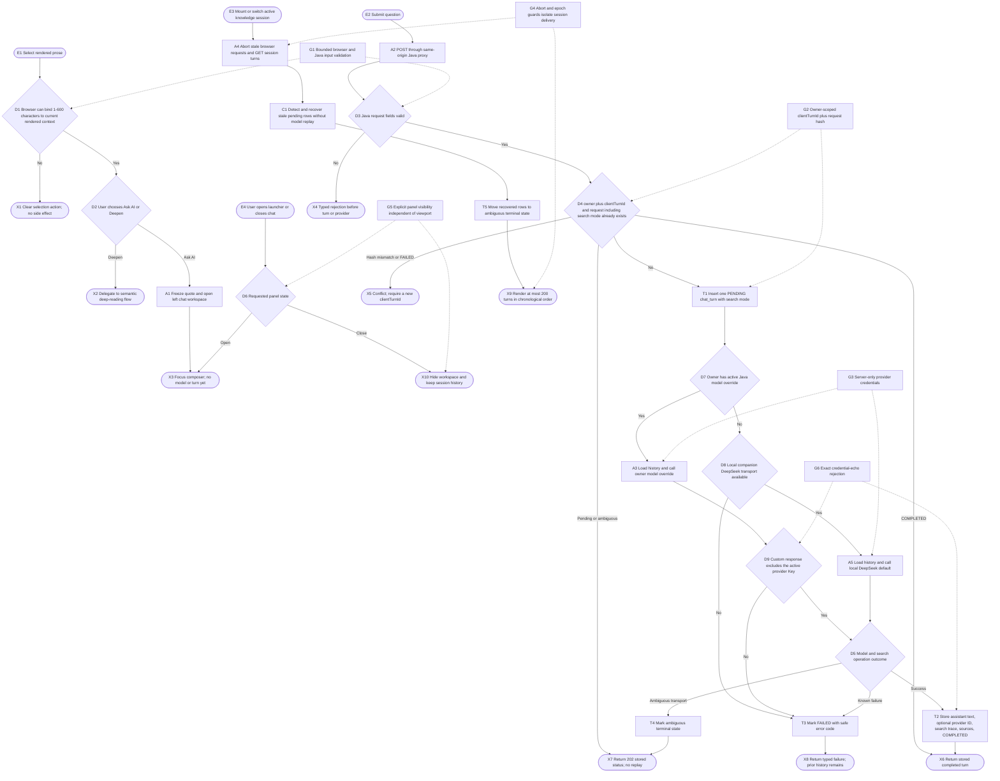
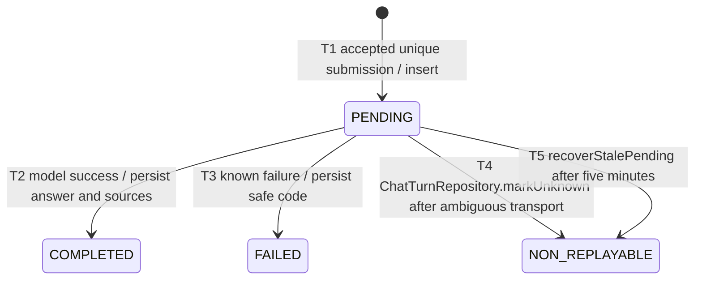

# Ask AI about selected text

## Purpose

Let a reader choose between two independent actions for selected prose:
`向 AI 提问` opens a left conversation workspace, while `深入` keeps the
existing structured deep-reading flow. The conversation workspace is closed by
default, can be opened from the persistent launcher or a selected quote, and can
be closed again without discarding history. Opening the chat only freezes the
quote in browser state. A model request starts only after the user submits a
question.

Each submitted turn carries an explicit search mode: `off`, `auto`, or `force`.
`off` never offers a tool; `auto` lets a compatible model decide whether current
facts need search; `force` requires at least one validated `web_search` call or
fails visibly. The returned turn records whether search was disabled,
unavailable, offered but skipped, used, or failed, so provider configuration is
not confused with actual execution.

The Java backend stores one ordered `chat_turns` history per knowledge-session
ID. A turn is one durable record containing the user question, selected text,
assistant answer, status, resolved model profile ID when applicable, search
mode/execution trace, and normalized search sources; there is no separate
thread/message aggregate. Chat turns remain separate from the canonical
`visual-knowledge-session/1` payload and never mutate the semantic document.

## Entry, preconditions, and terminal outcomes

- Entry: the user selects at most 600 characters in a rendered semantic node,
  term explanation, or deep explanation and chooses `向 AI 提问`; the independent
  `深入` button continues to use `visual-explanation.semantic-zoom`. The user may
  also open the chat without a selection from its persistent launcher.
- Preconditions for opening: the browser can associate the DOM selection with a
  node or currently rendered explanation when a quote is supplied. Opening or
  closing performs no persistence and no provider call.
- Preconditions for submission: session ID, client turn ID, question, node ID,
  selected text, search mode, and optional context-token shape pass Java
  validation. The
  current backend records the supplied node/context identity but does not
  cryptographically verify the context token or re-check that the selected text
  occurs in the stored semantic document.
- Success: a new `PENDING` turn resolves the owner's active Java model override,
  or falls back to the authenticated local DeepSeek companion when available.
  On success the same row becomes `COMPLETED` with assistant text, search
  execution trace, and any normalized sources produced by the model-owned tool
  loop.
- Duplicate recovery: the same owner-scoped `clientTurnId` and request hash
  returns the existing completed, pending, or ambiguous turn without another
  model call. Reusing it with a different payload is rejected.
- Failure: a known provider/configuration failure moves the row to `FAILED` and
  returns a typed error. An ambiguous model transport result, or a `PENDING`
  turn older than five minutes, moves to the ambiguous terminal state; neither is replayed
  automatically.

## Runtime flow



## Component sequence

```mermaid
sequenceDiagram
    actor U as User
    participant S as LineageStudio
    participant P as SelectionChatPanel
    participant B as Same-origin backend proxy
    participant J as ChatController and ChatService
    participant D as ChatTurnRepository
    participant M as OpenAiCompatibleChatClient

    U->>S: Select prose
    S-->>U: Show Ask AI and Deepen
    alt Deepen
        U->>S: Choose Deepen
        S->>S: Continue existing deep-reading flow
    else Ask AI
        U->>S: Choose Ask AI
        S->>P: Set sessionId and frozen selection
        P-->>U: Open composer without model request
        U->>P: Submit question
        P->>B: POST /api/backend/v1/chat/turns
        B->>J: Internal bearer plus device owner ID
        J->>D: Find by owner and clientTurnId
        alt Existing identical turn
            D-->>J: Existing status and content
        else New turn
            J->>D: Insert PENDING
            J->>D: Read up to 12 completed history turns
            J->>M: complete(owner, question, selection, history)
            opt Model requests web_search
                M->>M: Execute bounded tool loop from web-search contract
            end
            alt Custom provider response echoes its active Key
                M-->>J: Unsafe response rejected without body disclosure
                J->>D: PENDING to FAILED with safe code
            else Completion succeeds
                M-->>J: Text, provider ID, normalized sources
                J->>D: PENDING to COMPLETED
            else Known provider failure
                J->>D: PENDING to FAILED
            else Ambiguous model transport
                J->>D: PENDING to ambiguous terminal state
            end
        end
        J-->>P: HTTP 200, 202, or typed error
        P-->>U: Render matching session history or require refresh
    end
    U->>P: Close conversation workspace
    P-->>U: Hide panel; keep persisted and loaded history
```

## Persisted state lifecycle



`NON_REPLAYABLE` is a diagram-only semantic label. The authoritative persisted
value is the one written by `ChatTurnRepository.markUnknown`; the diagram does
not introduce a second status name.

## Safeguards and recovery

- G1 bounds selection text to 600 characters and question text to 4,000
  characters, validates IDs, and allows only the expected JSON fields.
- G2 uses a database uniqueness constraint on `(owner_id, client_turn_id)` plus
  a SHA-256 request hash. A completed duplicate is a read; pending and
  ambiguous duplicates return 202; a failed or conflicting ID must not be
  reused.
- G3 provider and search keys are decrypted only in Java provider clients and
  never appear in the turn DTO, source DTO, semantic session, or browser
  history.
- G4 keys the panel by active session ID, aborts prior list/send requests on
  unmount, and uses a local history epoch to discard stale list responses.
- G5 derives desktop workspace layout from `chatPanelOpen`, not viewport width.
  Closing only changes explicit panel visibility; it does not clear loaded or
  persisted history, and the launcher remains available while the panel is
  closed.
- G6 scans a successful custom-model response for the exact active API Key
  before parsing assistant content. A match becomes a known safe failure, so
  neither the browser nor `chat_turns` can receive the reflected credential.

The browser treats an unconfirmed POST result conservatively and requires a
history refresh before allowing another send. Java never automatically retries
an ambiguous model request. Chat list reads convert only stale `PENDING` rows
to the ambiguous terminal state; a user retry is a new turn with a new
`clientTurnId`.
