# Read and deepen a semantic explanation

## Purpose

The initial question composer has an explicit web-search option. Off preserves
the model-only path. On requires one bounded server-side search before visual
generation and permits only locally validated result references to become
canonical evidence.

Turn one complex question into a beginner-oriented, top-to-bottom explanation whose current layer is understandable before the reader chooses a branch. The root scene opens with a concise Mermaid concept graph generated locally from canonical root, child, and relation data; model-authored Mermaid, SVG, HTML, coordinates, and component code remain forbidden. Body copy and the object being explained carry more visual weight than headings. When a question targets an identifiable primary object, such as a poem, passage, statute, or code sample, the current scene presents that primary material before interpretation whenever it can do so without fabricating a source or reproducing protected material beyond the allowed excerpt. The current scene then gives orientation and ordered full-width entrances. After local hydration, the reader may select `省流 | 平衡 | 深入` before asking the first question; this empty-workspace choice remains in memory and is inherited by the first accepted session without itself creating a session, issuing model work, or becoming exportable knowledge. Rapid profile changes suspend background preparation immediately and coalesce to the latest stable selection before any replacement work starts. While the reader is reading an accepted document, the client may prepare only the next semantic frontier and current-layer short definitions within that selected hard budget. A single term activation uses Flash and opens or restores one independently dismissible card in a top-aligned explanation rail; a double activation or explicit `深入` action uses Pro. Selecting prose now exposes both `向 AI 提问` and `深入`: asking delegates to the separate left-side selection-chat flow and does not enter the structured dive path. `‹` and `›` remain the primary route controls.

Out of scope: generating the complete future graph, pixel-level model control, arbitrary component generation, silent browser-page capture, collaboration, and publication. Durable Java-backed sessions are governed by `visual-explanation.session-lifecycle`; credentials remain governed by `visual-explanation.model-credentials`; selection chat and its optional search tool are governed by `visual-explanation.selection-chat` and `visual-explanation.web-search`.

## Entry, preconditions, and terminal outcomes

- Entry: submit a question; enter an ordered section; use route arrows; activate an annotated term; activate a nested term; or select prose and explicitly choose `向 AI 提问` or `深入`.
- Preconditions: every POST must pass same-origin fetch metadata when present, use `application/json`, and stay within 4 MiB before parsing; create then requires 1–1,200 trimmed characters; expand requires a valid protocol-v2 document and an expandable node; define requires an allowed literal annotation; nested define requires a validated parent explanation; dive requires 1–600 literal characters from the current scene or validated explanation.
- Success: the root and each entered scene show a restrained title, prominent readable prose, any safely available primary material, and ordered entrances. Direct entrances are prepared one layer ahead. Flash definitions can contain bounded nested terms; several independent explanation cards may remain visible in the right rail, and dismissing one card does not evict its cached result. Invalid optional nested annotation candidates are dropped without discarding valid definition prose. Pro deep explanations are keyed by stable trusted-selection identity, so switching from A to B does not cancel or erase A; completed results can be restored without mutating document or history. Choosing `向 AI 提问` freezes the same selected quote for the chat panel without starting a semantic-lineage request or changing the document.
- Rejection: malformed documents, unsupported actions, stale versions, missing or terminal nodes, unlisted terms, non-literal selections, excessive recursion, or invalid core generated contracts fail before state adoption. Droppable optional annotation candidates never become interactive and do not trigger whole-result rejection.
- Failure: provider or validation failure preserves the last accepted document and route; background failure remains non-blocking.

## Runtime flow

```mermaid
flowchart TD
    E1(["E1 Submit question"]) --> D1{"D1 Valid bounded question"}
    D1 -->|No| X1(["X1 Inline rejection"])
    D1 -->|Yes| A1["A1 POST create and compact composer"]
    A1 --> D33{"D33 Trusted JSON request within 4 MiB"}
    D33 -->|Rejected| X35(["X35 Reject before search or model access"])
    D33 -->|Accepted| D30{"D30 Main-question search option"}
    D30 -->|Off| A2["A2 Resolve configured model"]
    D30 -->|On| A21["A21 Call bearer-protected Java internal search once"]
    A21 --> D31{"D31 Non-empty bounded HTTPS sources returned"}
    D31 -->|No| X33(["X33 Typed search failure before model generation"])
    D31 -->|Yes| A22["A22 Assign stable untrusted S1 through S5 evidence IDs"]
    A22 --> A2
    A2 --> A9["A9 Request action-specific draft"]
    A9 --> D9{"D9 Exact-Key-safe provider completion or classified failure"}
    D9 -->|Retryable once| C1["C1 Replay immutable request"]
    C1 --> A9
    D9 -->|Permanent, exhausted, or aborted| D25{"D25 Which request lane owns the failed issued request"}
    D9 -->|Available| D10{"D10 Local contract valid"}
    D10 -->|Repairable once| C2["C2 Bounded content repair"]
    C2 --> A9
    D10 -->|Invalid after repair| D26{"D26 Which request lane owns the invalid issued request"}
    D25 -->|Foreground| X2(["X2 Preserve accepted state"])
    D25 -->|Background scene| A17
    D25 -->|Background term| A18
    D26 -->|Foreground| X12(["X12 Reject generated content"])
    D26 -->|Background scene| A17
    D26 -->|Background term| A18
    D10 -->|Valid create| D32{"D32 Search evidence supplied for this create"}
    D32 -->|No| D2{"D2 Canonical graph, content, primary material, and math policy valid"}
    D32 -->|Yes| A23["A23 Validate stable references and map canonical source metadata"]
    A23 --> D2
    D2 -->|No| X2
    D2 -->|Yes| D20{"D20 Identifiable primary material requested"}
    D20 -->|No| A24["A24 Render a safe local Mermaid concept graph from canonical root data"]
    D20 -->|Public-domain or user supplied| X24(["X24 Show complete primary material"])
    D20 -->|Protected| X25(["X25 Show bounded excerpt and limitation"])
    D20 -->|Unavailable or unverifiable| X26(["X26 State unavailable; never fabricate"])
    X24 --> A24
    X25 --> A24
    X26 --> A24
    A24 --> X3(["X3 Render body-first reading flow"])
    E10(["E10 Select View large on the root concept graph"]) --> A25["A25 Open an isolated vector viewer with bounded zoom controls"]
    A25 --> X34(["X34 Close viewer and return to the unchanged reading flow"])

    X3 -.-> D21{"D21 Profile permits background scene work"}
    X7 -.-> D21
    X8 -.-> D21
    D21 -->|No or page hidden| X27(["X27 No background scene request"])
    D21 -->|Yes| D22{"D22 Scene frontier call budget remains"}
    D22 -->|No| X28(["X28 Scene budget exhausted"])
    D22 -->|Yes| A12["A12 Build bounded current-frontier scene queue"]
    A12 --> D14{"D14 Unexpanded direct entrance remains"}
    D14 -->|No| X15(["X15 Scene frontier prepared"])
    D14 -->|Yes| A13["A13 Sequential background expand with Pro"]
    A13 --> A9
    D10 -->|Valid background expand| D15{"D15 Base version and authority still match"}
    D15 -->|No; discarded| A17["A17 Settle exactly one scene receipt"]
    D15 -->|Yes; success| A17
    A17 --> D27{"D27 Scene result remains valid and authoritative"}
    D27 -->|No| X16(["X16 Discard stale or failed background result"])
    D27 -->|Yes| A6["A6 Apply operations and revalidate graph"]
    A6 --> A12

    E2(["E2 Activate ordered entrance"]) --> D3{"D3 Children already prepared or terminal"}
    D3 -->|Yes| A3["A3 Push route locally"]
    A3 --> X4(["X4 Show scene immediately"])
    D3 -->|No| A4["A4 Cancel background work; push route; POST foreground expand"]
    A4 --> D5{"D5 Existing expandable node and capacity"}
    D5 -->|No| X6(["X6 Structured rejection"])
    D5 -->|Yes| A5["A5 Prepare bounded parent context"]
    A5 --> A9
    D10 -->|Valid foreground expand| D6{"D6 Version, scope, graph, source, and content valid"}
    D6 -->|No| X2
    D6 -->|Yes| A6
    A6 --> X7(["X7 Show expanded linear scene"])

    E3(["E3 Select route arrow"]) --> A7["A7 Move history cursor only"]
    A7 --> X8(["X8 Show prior or next scene"])

    X3 -.-> D23{"D23 Profile permits background term work"}
    X7 -.-> D23
    X8 -.-> D23
    D23 -->|No or page hidden| X29(["X29 No background term request"])
    D23 -->|Yes| D24{"D24 Term frontier batch budget remains"}
    D24 -->|No| X30(["X30 Term budget exhausted"])
    D24 -->|Yes| A10["A10 Build bounded active-layer term batches"]
    A10 --> D13{"D13 Uncached eligible term remains"}
    D13 -->|No| X13(["X13 Current-layer terms prepared"])
    D13 -->|Yes| A11["A11 One-node background define batch with Flash"]
    A11 --> A9
    D10 -->|Valid background define| A18["A18 Settle exactly one term-batch receipt"]
    A18 --> D28{"D28 Definition result is valid and cacheable"}
    D28 -->|Yes| X14(["X14 Cache without opening UI"])
    D28 -->|No| D13
    X14 --> D13

    E4(["E4 Single-activate annotated term"]) --> D7{"D7 Base term allowed and literal"}
    D7 -->|No| X9(["X9 Structured rejection"])
    D7 -->|Yes| D18{"D18 Card task ready, pending, or absent"}
    D18 -->|Ready| X20(["X20 Restore cached card"])
    D18 -->|Pending| X21(["X21 Restore same loading card"])
    D18 -->|Absent| A8["A8 Start independent Flash definition"]
    A8 --> A9
    D10 -->|Valid define| X10(["X10 Add card to top-aligned rail"])

    E5(["E5 Activate nested term inside one card"]) --> D16{"D16 Parent explanation valid; term listed and literal; depth below four"}
    D16 -->|No| X9
    D16 -->|Yes| A14["A14 Define nested term with Flash"]
    A14 --> A9
    D10 -->|Valid nested define| X17(["X17 Push onto that card's local stack"])

    E6(["E6 Double-activate term"]) --> D17{"D17 Literal bounded selection in current trusted context"}
    D17 -->|No| X9
    D17 -->|Yes| D19{"D19 Deep task ready, pending, or absent"}
    D19 -->|Ready| X22(["X22 Restore cached deep reading"])
    D19 -->|Pending| X23(["X23 Focus existing task without cancelling it"])
    D19 -->|Absent and capacity available| A15["A15 Start selection-keyed Pro task"]
    A15 --> A9
    D10 -->|Valid dive| X18(["X18 Cache and show selection-keyed result"])

    E9(["E9 Select bounded prose"]) --> D29{"D29 Choose Ask AI or Deepen"}
    D29 -->|Deepen| D17
    D29 -->|Ask AI| A20["A20 Freeze quote and open selection chat"]
    A20 --> X32(["X32 Chat composer opens; semantic document and dive cache unchanged"])

    E7(["E7 Dismiss one explanation card"]) --> A16["A16 Remove visible card key only"]
    A16 --> X19(["X19 Cache and in-flight task remain"])

    E8(["E8 Select a pre-generation profile after hydration"]) --> A19["A19 Abort background controllers; suspend preparation; schedule only the latest profile intent"]
    A19 --> X31(["X31 Latest stable profile applies once; intermediate choices start no work"])

    G1["G1 Full graph validation"] -.-> D2
    G1 -.-> D6
    G1 -.-> A6
    G2["G2 Expansion scope isolation"] -.-> A5
    G2 -.-> D6
    G3["G3 Source-safety validation"] -.-> D2
    G3 -.-> D6
    G4["G4 Request identity, task isolation, and bounded cancellation"] -.-> A1
    G4 -.-> A4
    G4 -.-> A8
    G4 -.-> A13
    G4 -.-> A15
    G4 -.-> D18
    G4 -.-> D19
    G5["G5 Credential isolation and exact echo rejection"] -.-> A2
    G5 -.-> A9
    G6["G6 Content and boundary-safe annotation validation"] -.-> D2
    G6 -.-> D6
    G6 -.-> D7
    G6 -.-> D16
    G7["G7 Linear auto-sizing projection"] -.-> X3
    G7 -.-> X4
    G7 -.-> X7
    G7 -.-> X10
    G7 -.-> X18
    G7 -.-> X20
    G7 -.-> X21
    G8["G8 Deterministic canonical assembly"] -.-> D10
    G8 -.-> D2
    G8 -.-> D6
    G9["G9 Safe bounded diagnostics"] -.-> A9
    G9 -.-> C1
    G9 -.-> C2
    G10["G10 Stable current-layer definition cache"] -.-> A10
    G10 -.-> A11
    G11["G11 Pro scenes and dives; Flash definitions"] -.-> A9
    G11 -.-> A11
    G11 -.-> A13
    G11 -.-> A14
    G11 -.-> A15
    G12["G12 One-frontier sequential pre-generation"] -.-> A12
    G12 -.-> A13
    G12 -.-> D15
    G13["G13 Trusted recursive and selection context"] -.-> D16
    G13 -.-> D17
    G13 -.-> A14
    G13 -.-> A15
    G14["G14 Visibility independent from cache and task lifetime"] -.-> D18
    G14 -.-> D19
    G14 -.-> A16
    G14 -.-> X19
    G14 -.-> X20
    G14 -.-> X21
    G14 -.-> X22
    G14 -.-> X23
    G15["G15 Safe local Mermaid and semantic diagram projection"] -.-> A24
    G15 -.-> A25
    G15 -.-> X34
    G15 -.-> X3
    G15 -.-> X4
    G15 -.-> X7
    G16["G16 Avoid, optional, or requested math mode"] -.-> D2
    G16 -.-> D6
    G16 -.-> D10
    G16 -.-> A15
    G17["G17 Primary-material copyright and provenance boundary"] -.-> D20
    G17 -.-> X24
    G17 -.-> X25
    G17 -.-> X26
    G18["G18 Profile and hard frontier budgets"] -.-> D21
    G18 -.-> D22
    G18 -.-> D23
    G18 -.-> D24
    G18 -.-> A19
    G18 -.-> X31
    G19["G19 Provider-reported privacy-safe usage receipts"] -.-> A17
    G19 -.-> A18
    G20["G20 Ask and Deepen remain independent routes"] -.-> D29
    G20 -.-> A20
    G20 -.-> X32
    G21["G21 Explicit bounded search and canonical evidence boundary"] -.-> A21
    G21 -.-> A22
    G21 -.-> A23
    G22["G22 Same-origin JSON and body-size admission"] -.-> D33
    G22 -.-> A21
    G22 -.-> A9
```



## Component sequence

```mermaid
sequenceDiagram
    actor U as User
    participant C as LineageStudio
    participant R as POST /api/lineage
    participant W as Java internal search
    participant M as VisualModelPort
    participant P as DeepSeek or OpenAI
    participant V as Contract validators

    U->>C: Submit question
    C->>R: application/json action=create
    alt Cross-site, wrong media type, malformed, or over 4 MiB
        R-->>C: Typed rejection with no external call
        C-->>U: Keep prior accepted state
    else Request admitted
        alt Search off
            R->>M: create without search evidence
        else Search on
            R->>W: One bearer and owner scoped bounded search
            alt Search failure or empty results
                W-->>R: Typed failure before model generation
                R-->>C: Preserve prior accepted state
            else Bounded HTTPS sources
                W-->>R: Normalized sources
                R->>M: create with stable untrusted S1 through S5 evidence
            end
        end
        M->>P: Action-specific authenticated request
        P-->>M: Provider response
        M->>M: Reject an exact API Key echo before content use
        M->>V: Assemble and validate canonical root
        V-->>C: Root document
        C-->>U: Direct answer, orienting detail, ordered entrances
    end

    C->>C: Build one-frontier plan from profile, receipts, and current reservations
    alt on_demand, hidden page, or exhausted hard budget
        C-->>U: Start no background request
    else Planned background work remains
        par Current semantic frontier
            loop Within profile scene-call limit
                C->>R: action=expand, latest document, child node
                R->>M: expand with deepseek-v4-pro
                M->>V: Validate scoped operations
                V-->>C: Response plus provider-reported usage
                C->>C: Settle one success, error, abort, or discard receipt
            end
        and Current-layer definitions
            loop Within profile term-batch limit
                C->>R: action=define_batch, at most eight annotations
                R->>M: defineTerms with deepseek-v4-flash
                M-->>C: Response plus provider-reported usage
                C->>C: Settle one success, error, abort, or discard receipt
            end
        end
    end

    U->>C: Rapidly select pre-generation profiles after hydration
    C->>C: Abort background controllers and switch effective preparation to on-demand
    C->>C: Replace the pending settle timer and retain only the latest profile intent
    alt Accepted document exists
        C-->>U: Keep foreground tasks and completed caches; start one latest stable hard budget
    else Empty hydrated workspace
        C-->>U: Keep profile in memory for the first accepted session
        C->>C: Start no model request and create no persisted or exportable session
    end

    U->>C: Enter prepared section
    C->>C: Push route with no model request
    C-->>U: Next linear scene immediately
    C->>C: Move both preparation frontiers to the new active scene

    U->>C: Single-activate term A
    alt Ready in task cache
        C-->>U: Restore card A immediately
    else Already pending
        C-->>U: Restore the same loading card A
    else Absent
        C->>R: Independent action=define for A
        R->>M: Flash definition
        M-->>C: Definition plus nested term allowlist
        C-->>U: Add card A to the top-aligned rail
    end

    U->>C: Single-activate term B
    C->>C: Keep card and task A; add or restore B
    C-->>U: Cards A and B remain independently visible

    U->>C: Dismiss card A
    C->>C: Remove only A's visible key
    C-->>U: Cached or pending A remains recoverable

    U->>C: Activate nested definition term
    C->>R: action=define with validated parent explanation
    R->>M: Flash nested definition
    M-->>C: Push validated result onto stack

    U->>C: Double-activate A, then B
    C->>C: Derive stable trusted identities for A and B
    par Deep task A
        C->>R: action=dive A
        R->>M: deepDive A with deepseek-v4-pro
        M-->>C: validated result A
    and Deep task B
        C->>R: action=dive B
        R->>M: deepDive B with deepseek-v4-pro
        M-->>C: validated result B
    end
    C->>C: Cache each result under its own identity
    C-->>U: Restore A or B without restarting either task

    U->>C: Select prose
    C-->>U: Show Ask AI and Deepen
    alt Ask AI
        U->>C: Choose Ask AI
        C->>C: Freeze session ID, node ID, quote, and optional context token
        C-->>U: Open left chat composer; delegate to selection-chat contract
    else Deepen
        U->>C: Choose Deepen
        C->>R: action=dive with trusted selected prose
        R->>M: deepDive with deepseek-v4-pro
        M-->>C: Validated structured deep explanation
    end

    U->>C: Select ‹ or ›
    C->>C: Move route cursor only
    C-->>U: Existing scene, no foreground model request
```

## State lifecycle

The canonical document protocol still contains no persistence, chat, or
model-policy fields. `visual-explanation.session-lifecycle` durably wraps the
accepted document, route history, completed definition/deep caches, selected
profile, and privacy-safe receipts in Java-backed session storage. Selection
chat persists separately as `chat_turns` under the same session ID. Pending
semantic tasks, failure identities, controllers, request epochs, text selection,
and the current frozen chat quote remain runtime-only. Closing a card or
changing deep focus never evicts its task. A new root document creates a new
session and cache scope.

## Safeguards

- G1: every accepted document has one depth-0 root, consistent parent and child links, no cycles, at most 80 nodes, at most 8 direct children, and same-scene relations only.
- G2: expansion adds only 3–5 direct children of the selected node, may update only that selected node, and leaves siblings unchanged.
- G3: model output cannot invent evidence when no retrieval source was supplied.
- G4: document work remains epoch-guarded; definition and dive work use stable trusted-content keys and independent controllers. Selecting B does not cancel A. Explicit document replacement, source-content invalidation, unmount, or bounded-capacity eviction may cancel work, and a late response can update only its own task entry.
- G5: credentials stay in server or authenticated companion boundaries and never enter documents, browser persistence, prompts logged to diagnostics, or responses. DeepSeek and OpenAI reject a successful payload containing the exact active API Key before status handling, content extraction, validation, or state adoption.
- G6: summaries and details are bounded, non-repetitive explanatory prose; every interactive term occurs literally at a renderable semantic boundary. ASCII word edges stay intact, longer terms win overlaps, and a one-character Han term cannot split an ordinary compound. Short-definition nested terms are optional derived annotations: invalid candidates are dropped in stable order, while definition/relevance, source state, signed parent context, recursion, and math rules remain hard failures.
- G7: the projection is one normal-flow reading column with headings smaller and quieter than the direct answer and explanatory body, wrapping content, and no clipping or radial positioning. On desktop, visible term cards occupy a top-aligned right rail below the composer; the rail scrolls independently when needed and does not cover the reading column. Narrow layouts use a bounded bottom region.
- G8: model drafts cannot choose canonical IDs, versions, parent links, depth, evidence arrays, expansion state, or relation endpoint IDs.
- G9: retry and repair are independently bounded; diagnostics exclude prompts, questions, selected text, response bodies, and credentials.
- G10: definition work includes only the active scene and visible direct entrances, batches at most eight annotations from one node, runs one batch at a time, prioritizes the active scene, and caches by trusted-content fingerprints.
- G11: create, expand, and dive use `deepseek-v4-pro`; base and nested define use `deepseek-v4-flash`; both use the same credential path.
- G12: scene preparation is sequential, uses the latest document version, adopts only matching authoritative responses, and stops after one semantic frontier.
- G13: nested terms must be allowlisted and literal in a validated parent explanation; deep selections must be literal in the current scene or validated explanation and are capped at 600 characters.
- G14: card visibility, cached content, and request lifetime are three separate state dimensions. Dismissal changes only visibility; reopening a ready or pending identity never starts a duplicate request.
- G15: architecture, sequence, comparison, and relationship diagrams are deterministic renderer projections of canonical nodes, ordered child IDs, relations, and `view`. The model cannot emit Mermaid text, SVG, HTML, coordinates, styles, or component names. The enlarged viewer reuses the same isolated vector image, clamps local scale to 100–300%, and closes without changing canonical knowledge or navigation.
- G16: math mode is derived as `avoid`, `optional`, or `requested`. Explicit no-math language forbids notation. Explicit math requests allow it. The default optional mode permits only a small formula when it materially removes ambiguity, and every formula must be followed by a plain-language interpretation.
- G17: identifiable primary material is complete only when user-supplied or safely public-domain; protected work is limited to a necessary excerpt; unavailable or unverifiable material is labeled instead of reconstructed from model memory. Model knowledge is never relabeled as source-backed evidence.
- G18: `on_demand` starts zero background requests; `balanced` and `deep` have
  explicit per-frontier scene and term-batch limits after prior matching
  receipts and current reservations are charged. All profiles stay within one
  frontier. A profile click immediately suspends effective background work,
  aborts only scene and term background controllers, and replaces a bounded
  settle timer; only the latest stable choice may restart preparation. A
  cancelled current scene returns from `preparing` to `idle`, while a stale
  controller cannot mark replacement work failed. Completed knowledge and
  foreground work remain intact. In a hydrated empty workspace there is no
  accepted document, so changing profile cannot schedule preparation, create a
  persisted history record, or expose an export action; the first accepted
  session inherits the in-memory selection.
- G19: every issued background request settles exactly one receipt for success,
  error, abort, or discarded response; work cancelled before request issuance
  creates no receipt. DeepSeek usage is accepted only from numeric provider
  response fields. Receipts distinguish foreground/background and never contain
  prompt, question, selection, response body or credential data.
- G20: `SelectionAction` exposes separate callbacks. `askAboutSelectedText`
  transfers the frozen quote to `SelectionChatPanel` and clears the browser
  selection without calling `/api/lineage`; `deepenSelectedText` continues to
  `requestDeepReading`. Chat turns therefore cannot be adopted as canonical
  semantic nodes or deep-reading cache entries.

## Failure, recovery, and observability

Provider calls retain the existing 90-second timeout, one immutable-request retry for transient failures, and one independent content-repair attempt. Repair uses a safe category plus category-specific guidance; specific relation, source, math-preference, term, and content failures take precedence over generic child-shape matching. The repair prompt also repeats the original Schema/count/source/math invariant so one correction cannot introduce a new class of violation. Authentication, balance, invalid parameters, and content filtering do not retry. A foreground failure updates only its own task entry and preserves accepted knowledge, sibling explanation cards, and other in-flight tasks. Dismissing a loading card does not abort it; reopening shows its current state. Background scene or definition failure is recorded against a stable content identity to avoid retry storms and never opens a dialog. Prepared-hit latency, provider first-token time, and complete validated-result time remain separately named metrics.

## Implementation notes

The canonical semantic protocol remains independent of projection. Existing `summary` becomes the prominent direct answer; multi-paragraph `detail` carries orientation; ordered `childIds` define the reading sequence. A bounded optional primary-material semantic field can be projected as a reading block before interpretation, but it never contains presentation instructions. Diagram projection consumes only existing semantic relationships. Annotation sanitation and `AnnotatedText` share one boundary matcher, so an allowlisted term cannot be accepted under one substring rule and rendered under another. Rejected optional candidates disappear before canonical adoption rather than invalidating useful prose.
