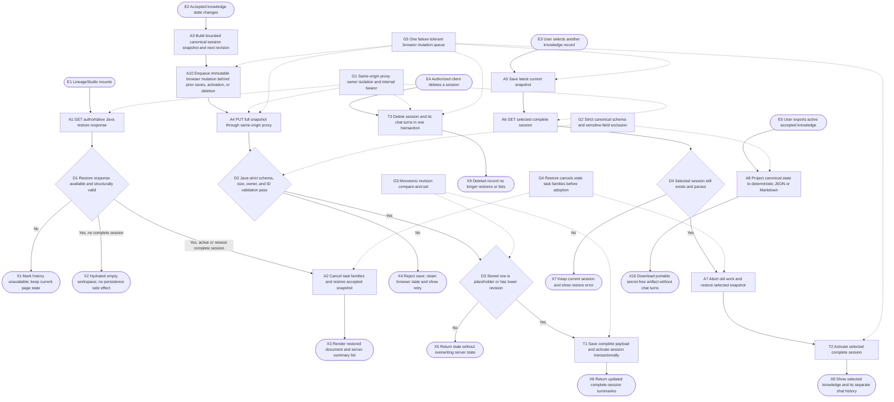
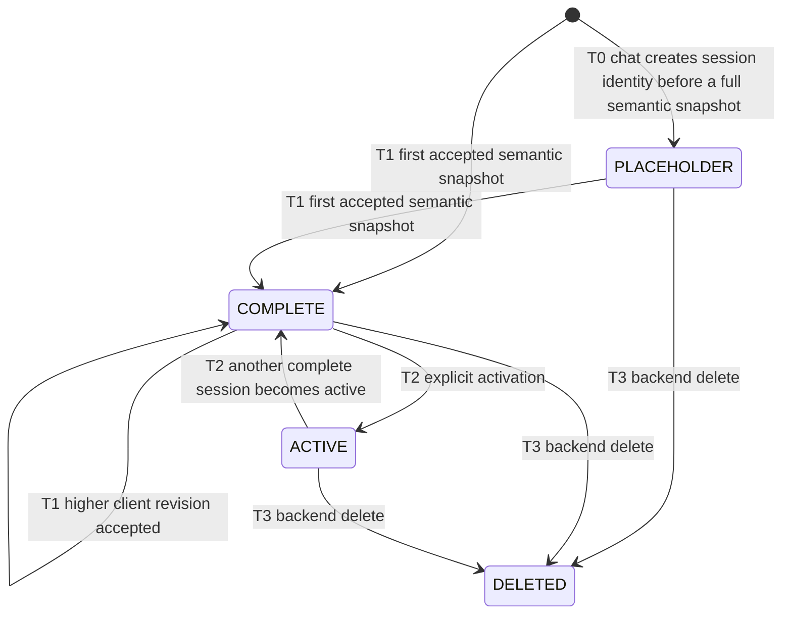

# Persist and restore knowledge sessions

## Purpose

Make the Java backend the durable authority for accepted
`visual-knowledge-session/1` records. `LineageStudio` uses
`BackendKnowledgeSessionRepository`, which calls the same-origin
`/api/backend/v1/sessions` proxy; the proxy adds a device-scoped owner ID and
the internal Java bearer. The older `IndexedDbKnowledgeSessionRepository`
remains in the repository as an offline implementation and retains its own
tests, but it is not the repository selected by the current application.

A knowledge-session snapshot owns the accepted semantic document, navigation,
completed term/deep explanation caches, visible cache references,
pre-generation profile, and bounded usage receipts. Selection-chat turns are
stored separately in `chat_turns` under the same session ID. They are not part
of the portable semantic snapshot or export.

## Entry, preconditions, and terminal outcomes

- Boot: after the component mounts, the browser reads `/sessions/restore`.
  Java returns only complete sessions, chooses the owner’s active complete
  session when present, otherwise the newest complete session, and returns at
  most 50 summaries. With no saved session the workspace becomes ready and no
  session is created.
- First save: a successful semantic `create` allocates a `knowledge-*` ID in the
  browser. The autosave effect builds revision 1 and sends the complete strict
  protocol to Java.
- Subsequent save: accepted document/navigation/cache/profile/receipt changes
  build a new immutable snapshot and monotonically increment the client
  revision. The browser serializes every save, activate, and delete mutation in
  one failure-tolerant queue before network I/O. Java accepts only a placeholder
  or a lower stored revision.
- Stale write: equal or lower revision returns `saved=false, stale=true` and
  never overwrites newer server state. The current browser marks the latest
  request as saved but does not automatically reload the newer server record.
- Session switch: the browser first saves its latest snapshot, reads the chosen
  complete session, cancels document/background/term/deep work, restores only
  validated completed state, then activates the chosen server record.
- Backend delete: `DELETE /sessions/{id}` transactionally deletes the session
  and its `chat_turns`. The current `KnowledgeSessionControls` UI does not expose
  a delete action.
- Backend unavailable or invalid response: the UI reports an error or
  current-page-only state. It does not silently fall back to IndexedDB.

## Runtime flow



## Component sequence

```mermaid
sequenceDiagram
    actor U as User
    participant S as LineageStudio
    participant R as BackendKnowledgeSessionRepository
    participant B as Same-origin backend proxy
    participant J as KnowledgeSessionController and Service
    participant D as KnowledgeSessionRepository database

    S->>R: restoreLatest()
    R->>B: GET /api/backend/v1/sessions/restore
    B->>J: Internal bearer plus owner ID
    J->>D: List complete sessions and active ID
    D-->>J: Active or newest record plus up to 50 summaries
    J-->>R: Strict restore envelope
    alt Complete session exists
        R-->>S: Parsed visual-knowledge-session/1
        S->>S: Abort old tasks and adopt completed snapshot
    else Empty
        R-->>S: null session and empty summaries
    end

    U->>S: Change accepted document, route, cache, profile, or receipts
    S->>S: Build immutable snapshot with next revision
    S->>R: save(snapshot)
    R->>R: Enqueue immutable mutation after the prior mutation settles
    R->>B: PUT /api/backend/v1/sessions/{id}
    B->>J: Owner-scoped strict JSON
    J->>J: Validate exact protocol, shape, bounds, timestamps, and size
    J->>D: Update only placeholder or lower revision
    alt Accepted
        D->>D: Save payload and activate in transaction
        D-->>S: saved true and summaries
    else Stale
        D-->>S: saved false stale true; stored payload unchanged
    else Invalid or unavailable
        J-->>S: Typed error
        S-->>U: Retry control; current accepted state remains
    end

    U->>S: Select another server summary
    S->>R: Save current latest snapshot
    S->>R: read(selectedId)
    R->>J: GET selected complete session
    J-->>S: Strict session or null
    S->>S: Abort old tasks and restore selected session
    S->>R: activate(selectedId)
    R->>J: POST /sessions/{id}/activate
    J->>D: Clear prior active flag and set selected active
```

## Persisted state lifecycle



## Safeguards and recovery

- G1 uses an HttpOnly `vexp_owner` cookie at the web boundary, hashes the owner
  identity in Java, and requires the launcher-generated internal bearer when
  configured. This is device-scoped isolation, not account login or multi-device
  synchronization.
- G2 parses the full client snapshot before sending, then Java rejects unsupported
  top-level/document/node/relation fields, invalid bounds, forbidden sensitive
  field names, inconsistent IDs/timestamps, unsupported protocols, and payloads
  over 3.5 MiB. Export is separately projected from accepted state and excludes
  chat turns.
- G3 commits only a higher revision or the first complete payload replacing a
  placeholder. Equal/lower revisions are read-only stale outcomes.
- G4 aborts document, scene prefetch, term prefetch, term jobs, and deep jobs
  before restoring another snapshot. Only completed cache entries and valid
  context tokens in the accepted snapshot are adopted.
- G5 captures each parsed snapshot at enqueue time and serializes `save`,
  `activate`, and `delete` through one queue. A rejected mutation releases the
  queue so later work can continue; concurrent profile autosaves cannot overlap
  or pass a session activation/deletion request.

`pagehide` sends a best-effort repeat of the latest snapshot, which is safe
because the server revision check makes it idempotent/stale. There is no
automatic server-to-IndexedDB fallback and no automatic stale-write merge.
