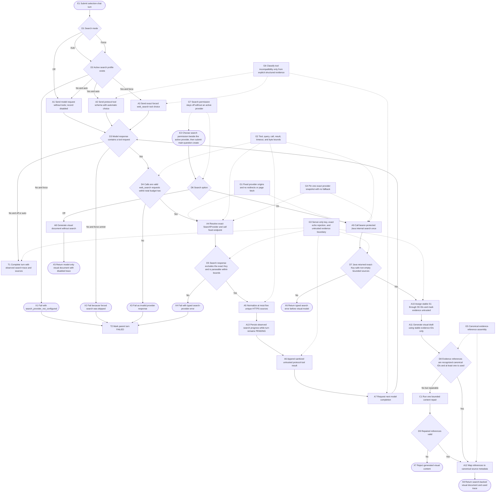
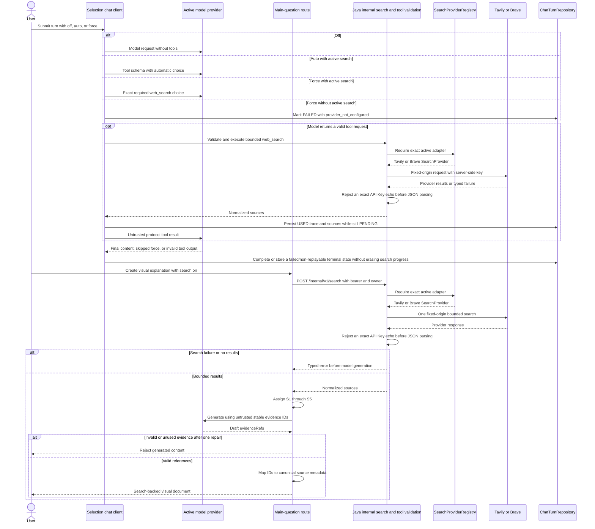
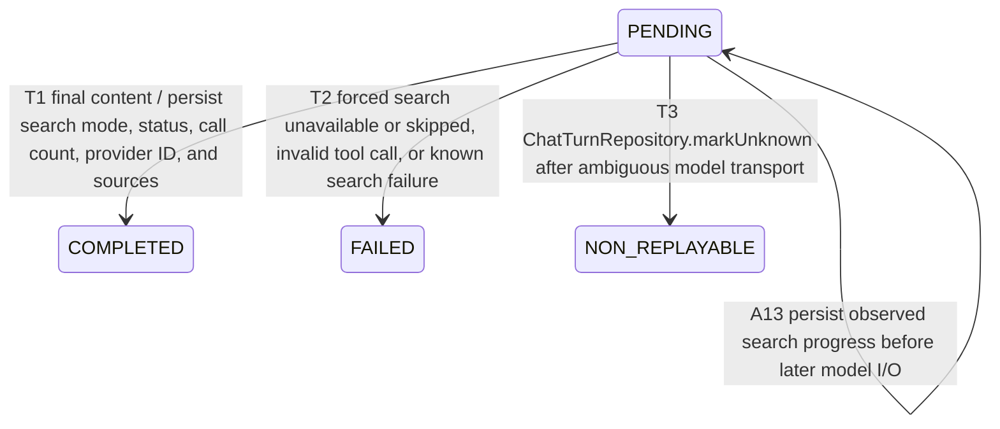

# Use bounded web search during AI generation

## Purpose

Use one Java-owned search-provider boundary for both user entry points:

1. Selection chat exposes a `web_search` function to the active model according
   to the turn's explicit `off | auto | force` mode. Java validates every tool
   call, dispatches the active profile through `SearchProviderRegistry`, appends
   a sanitized protocol-specific tool result, and asks the model for the next
   message. `force` requires at least one call; `auto` records when the model
   skips it.
2. Main-question visual generation exposes a binary search option beside the
   search-provider settings instead of in the primary composer. The option is
   off by default and cannot be enabled until an active search profile exists.
   When on, the
   server route performs one deterministic bounded search through a
   bearer-protected Java internal endpoint before calling the visual model. The
   model may reference only stable IDs from those results, and local assembly
  maps valid references to canonical evidence. When off, no search request is
   made.

Tavily is the default search preset for the current product, while Brave is a
second concrete adapter. Future search providers extend the SPI and
registration set without changing either consumer. There is no browser-visible
general search endpoint.

The tool searches a fixed provider endpoint only. It does not fetch result
pages, follow model-supplied URLs, execute returned content, or expose a general
browser/HTTP tool. Search evidence is explicitly marked untrusted before it is
returned to the model.

## Entry, preconditions, and terminal outcomes

- Entry A: selection chat validates the turn's search mode before constructing
  an OpenAI Chat Completions or Anthropic Messages request.
- Entry B: main visual creation validates its `off | on` option before any
  provider call.
- Availability: `off` omits all search work. `auto` without an active search
  profile records `unavailable` and omits tools. `force` or main-question `on`
  without an active search profile fails with
  `search_provider_not_configured`.
- Validation: only the function name `web_search` is allowed; tool-call IDs must
  be bounded and unique within one response; arguments must be a JSON object
  containing only `query` and optional `freshness`; query length is 1–300;
  freshness is `any | day | week | month | year`.
- Budgets: at most two tool calls are accepted in one chat completion loop and
  every search asks for at most five results.
- Success: Java resolves one immutable snapshot of the active Tavily or Brave
  profile for the loop, calls that exact adapter, keeps unique results
  with non-empty titles and HTTPS URLs, bounds title/snippet/date/URL fields,
  immediately persists completed-search progress while the turn is still
  `PENDING`, appends an `EXTERNAL_UNTRUSTED_EVIDENCE` tool result, then requests
  the final model answer. The normalized results therefore remain auditable
  even if that later model request is known-failed or ambiguous. Main visual
  creation maps only
  model-selected stable result IDs into canonical node evidence; an unrecognized ID
  is rejected rather than turned into a model-supplied URL.
- Failure: malformed or over-budget tool calls are classified as an invalid
  model response. Search timeout, rate limit, invalid credentials, or provider
  failure aborts the turn as a known failure; it is not converted into a fake
  successful tool result and there is no hidden provider fallback or retry.
  Only an explicit structured upstream error that names `tools` or
  `tool_choice` is classified as `model_tools_unsupported`; a generic
  companion/provider rejection retains its original typed failure.

## Runtime flow

## Component sequence

## Persisted turn state

`NON_REPLAYABLE` is a diagram-only semantic label. T3 points to
`ChatTurnRepository.markUnknown`, which remains the authoritative persisted
status transition.

## Safeguards and recovery

- G1 selects Tavily or Brave from fixed server presets. `SafeHttpClient` follows
  no redirects, and the model cannot choose the host or cause Java to fetch a
  returned result URL.
- G2 allows at most two tool calls, five results per call, a 300-character
  query, a 45-second upstream request timeout, and a 2 MiB response cap. Tool
  arguments allow no extra keys. Source titles, snippets, dates, and URLs are
  bounded, and only HTTPS source URLs survive normalization.
- G3 decrypts the active search key only in Java. Tavily and Brave compare every
  successful raw response with the exact active Key before JSON parsing; an
  echo returns `provider_response_rejected` and no source or tool result is
  used, persisted, or returned. Safe tool content carries an explicit
  untrusted-evidence notice so snippets cannot legitimately redefine
  system/tool policy.
- G4 registers exactly one adapter for each implemented search provider.
  `ProviderWebSearchClient.findActive` resolves the owner profile once into a
  `SearchSession` containing both the decrypted provider snapshot and its
  configuration ID. Every call in the loop uses that pinned session, so a
  concurrent activation change cannot make execution and audit identity refer
  to different profiles. Duplicate or non-search registrations fail
  application startup; a missing adapter returns
  `search_provider_unsupported`. There is no implicit adapter selection and no
  cross-provider fallback.

- G5 accepts only locally assigned `S1` through `S5` references, maps them to
  the server-held canonical URL/title/snippet values, and requires at least one
  accepted reference when main-question search is on.

- G6 maps a model/provider response to `model_tools_unsupported` only when a
  structured error explicitly refers to `tools` or `tool_choice`. Ordinary
  authentication, validation, endpoint, or companion failures keep their
  original classification; the system never retries by silently removing the
  tool contract.

There is no automatic Tavily-to-Brave fallback and no automatic search retry.
Selection-chat `auto` may continue without live sources when no search profile
exists, but `force` fails. Main-question `on` fails before visual generation on
configuration, provider, empty-result, or internal-response errors. A generated
document with invalid or unused search evidence is rejected after at most one
bounded content repair. `offered` means the model was allowed to search but no
completed or failed search call was recorded; it is not proof that the model
never attempted one. Once a search succeeds, the `used` trace and sources are
written before the next model request: a known later failure moves the turn to
`FAILED`, while an ambiguous later transport uses the repository's
non-replayable transition, and both terminal states retain that observed search
evidence.
